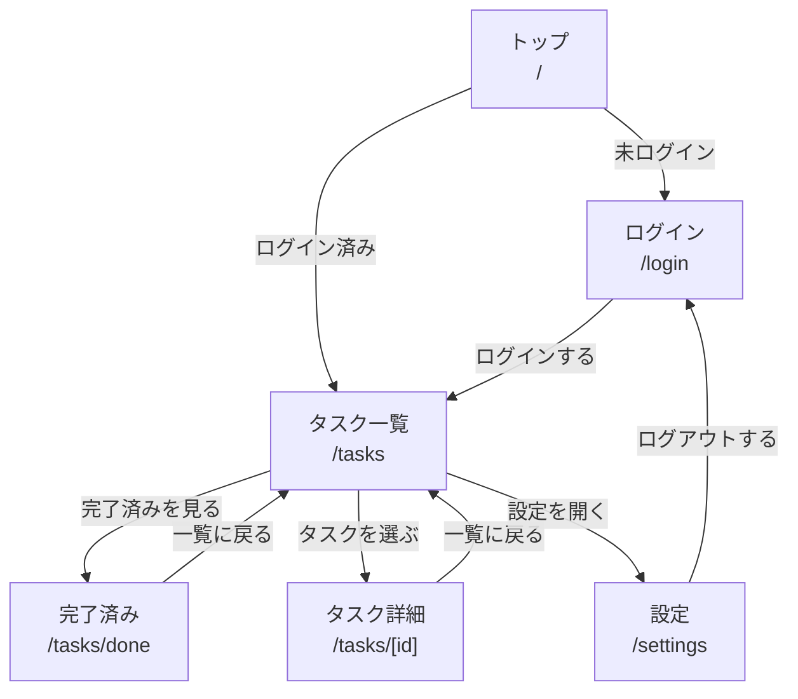
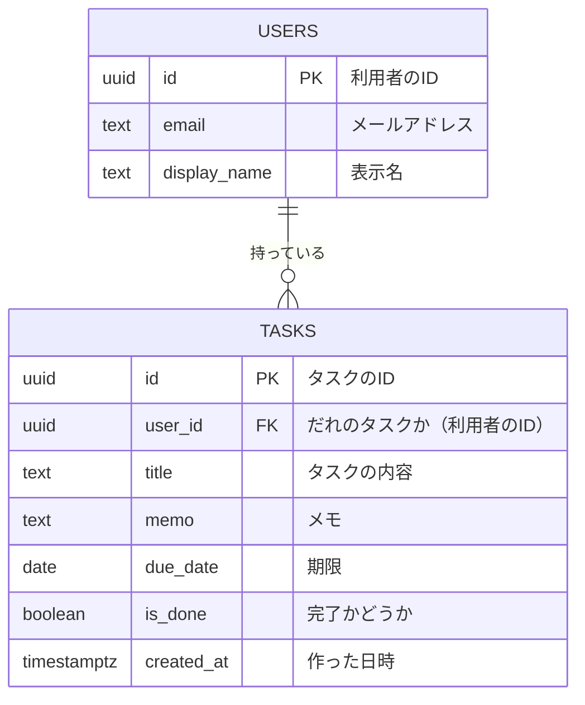

# 要件定義書：タスク管理アプリ（task-manager）

## プロジェクト概要

やることを忘れずに管理し、終わったかどうかをひと目で確認できるWebアプリを作る。

## 想定利用者

やることを忘れずに管理したい個人。

## 解決する課題

やることを頭の中やメモでバラバラに管理していると、忘れたり、終わったかどうか分からなくなったりする。

## 解決方法

ログインした本人だけが見られるタスク一覧に、やることを追加・完了・削除できるようにする。データは保存されるので、ページを閉じても消えない。
タスクごとにメモや期限を残せるようにし、終わったタスクは別のページでまとめて見られるようにする。

## 必須機能

Day1 の必須機能（講座の前提）

1. ログイン
2. ログアウト
3. タスクの追加
4. タスクの一覧表示
5. タスクの完了
6. タスクの削除

追加する機能

7. タスクの編集（内容・メモ・期限を変える）
8. 完了済みタスクの一覧表示
9. 表示名の変更

## 今回は作らないもの

- 会員登録・パスワード再発行
- 複数人で一つのリストを共有すること
- 通知・リマインダー
- カテゴリー分け・検索

## ページ構造

| ページ | URL | できること |
|---|---|---|
| トップページ | `/` | 画面は持たない。ログイン済みなら `/tasks`、未ログインなら `/login` へ自動で移動する |
| ログインページ | `/login` | メールアドレスとパスワードでログインする |
| タスク一覧ページ | `/tasks` | 未完了のタスクの一覧表示・追加・完了・削除 |
| 完了済みタスクページ | `/tasks/done` | 完了したタスクだけを一覧で見る |
| タスク詳細ページ | `/tasks/[id]` | タスクの内容・メモ・期限の編集、削除（`[id]` にはタスクのIDが入る。例：`/tasks/123`） |
| 設定ページ | `/settings` | 表示名の変更、ログアウト |

```text
/               トップページ
/login          ログインページ
/tasks          タスク一覧ページ
├─ /tasks/done      完了済みタスクページ
└─ /tasks/[id]      タスク詳細ページ
/settings       設定ページ
```



- ログインしていない人が `/login` 以外のページを開いたときは、ログインページへ移動する
- ほかの人のタスクの詳細ページ（`/tasks/[id]`）は開けない

## データアーキテクチャ



**users（利用者）テーブル**

| カラム名 | 型 | 必須 | キー | 説明 |
|---|---|---|---|---|
| `id` | uuid | ○ | 主キー | 利用者のID |
| `email` | text | ○ | | メールアドレス |
| `display_name` | text | | | 表示名（設定ページで変更する） |

**tasks（タスク）テーブル**

| カラム名 | 型 | 必須 | キー | 説明 |
|---|---|---|---|---|
| `id` | uuid | ○ | 主キー | タスクのID |
| `user_id` | uuid | ○ | 外部キー → `users.id` | だれのタスクか |
| `title` | text | ○ | | タスクの内容 |
| `memo` | text | | | メモ（空でもよい） |
| `due_date` | date | | | 期限（空でもよい） |
| `is_done` | boolean | ○ | | 完了かどうか（最初は false＝未完了） |
| `created_at` | timestamptz | ○ | | 作った日時 |

用語メモ：
- **主キー（PK）**：そのデータを1つに決めるための番号
- **外部キー（FK）**：ほかのテーブルとつなぐための番号
- **型**：uuid＝重ならないID、text＝文字、date＝日付、boolean＝はい／いいえ、timestamptz＝日時

- **USERS（利用者）** と **TASKS（タスク）** の2種類の情報を保存する
- 利用者1人に対して、タスクは0個以上ある（図の `||--o{` は「1人に対して複数」という意味）
- タスクの `user_id` で、だれのタスクかをつなげる
- ログイン中の利用者は、自分のタスクだけを見たり操作したりできる
- 細かな見た目や SQL（データベースへの命令文）は、この段階では決めない

## 扱う情報

| 情報 | 項目 |
|---|---|
| 利用者 | ID、メールアドレス、表示名 |
| タスク | ID、内容、メモ、期限、完了かどうか、`user_id`、作った日時 |

## 完了条件

Day1 の必須機能

- [ ] 正しいメールアドレスとパスワードでログインすると、自分のタスク一覧が表示される
- [ ] タスクを入力して追加すると、一覧に表示される
- [ ] 完了にすると、タスク一覧から消え、完了済みタスクページに表示される
- [ ] 削除すると、一覧から消える
- [ ] ページを再読み込みしても、タスクが消えていない
- [ ] ログアウトするとログインページに戻り、ほかのページは見られなくなる

追加する機能

- [ ] トップページ（`/`）を開くと、ログイン状態に合わせてログインページかタスク一覧ページに移動する
- [ ] タスク一覧でタスクを選ぶと詳細ページが開き、内容・メモ・期限を変えて保存すると、一覧にも反映される
- [ ] 完了済みタスクページには、完了したタスクだけが表示される
- [ ] 設定ページで表示名を変えると、再読み込みしても変えた名前のまま残っている
- [ ] ログインしていない状態で `/tasks` などを開くと、ログインページに移動する

## 未決定事項

- アプリの画面に表示する名前（今は仮に「タスク管理アプリ」）
- 利用者アカウントの作り方（会員登録画面は作らないため、事前にどう用意するか）
- 完了済みのタスクを「未完了に戻す」ことができるようにするか
- 表示名をどこに表示するか（ヘッダーなど）
- 期限が過ぎたタスクを目立たせるか
